# Student Placement Management System
### Case Study No. 31 — Semester III Java Programming Project

[](https://www.oracle.com/java/)
[](https://docs.oracle.com/javase/8/docs/technotes/guides/swing/)
[]()
[]()
[-red.svg)](./PROJECT_REPORT.pdf)

---

## 📌 Academic Submission Details

| Field | Details |
| :--- | :--- |
| **Student Name** | **Aaroh Wankhade** |
| **Student ID / PRN** | **150096726175** |
| **Course** | Java Programming |
| **Program** | B.Tech Computer Science & Engineering (2025–2029) |
| **Semester** | Semester III |
| **Case Study** | **Case Study 31: Student Placement Management System** |
| **Institution** | School of FutureTech, ITM Skills University |
| **Official Report** | [📄 Download PROJECT_REPORT.pdf](./PROJECT_REPORT.pdf) |
| **GitHub Repository** | [🔗 student-placement-management-system](https://github.com/aarohwankh-dotcom/student-placement-management-system) |

---

## 📖 Table of Contents
1. [Project Overview](#1-project-overview)
2. [Problem Statement & Objectives](#2-problem-statement--objectives)
3. [Technology Stack & Syllabus Alignment](#3-technology-stack--syllabus-alignment)
4. [Data Structures & Architecture](#4-data-structures--architecture)
5. [System Workflows & Architectural Diagrams](#5-system-workflows--architectural-diagrams)
6. [How to Compile and Run](#6-how-to-compile-and-run)
7. [GUI Screenshots & Module Walkthrough](#7-gui-screenshots--module-walkthrough)
8. [Exception Handling & Validation](#8-exception-handling--validation)
9. [Repository File Structure](#9-repository-file-structure)
10. [Submission Files Summary](#10-submission-files-summary)

---

## 1. Project Overview

The **Student Placement Management System** is a standalone, enterprise-grade desktop application built entirely in **Core Java (Java SE)** and **Java Swing**. It provides a fully digitized platform for university training and placement cells to manage student profiles, recruiting companies, job openings, automated two-phase candidate eligibility screening, application lifecycles, interview scheduling, and placement analytics.

The application strictly aligns with **Case Study 31** and the official **Semester III Java Programming Syllabus**, demonstrating core Object-Oriented Programming (OOP) paradigms, the Java Collections Framework (`ArrayList`, `LinkedList`, `HashMap`, `TreeMap`), user-defined exceptions, sorting algorithms (Bubble Sort), and Swing event architecture without any external third-party libraries or external database servers.

---

## 2. Problem Statement & Objectives

### Problem Statement
Managing campus placement drives manually using flat spreadsheets or paperwork leads to human error, duplicate registrations, misplaced records, slow eligibility screening, and scheduling conflicts. The university placement cell requires a robust, self-contained desktop system to manage student profiles, track corporate job vacancies, automate eligibility verification, manage interviews, and generate real-time placement statistics.

### Key Objectives
1. **Student & Company Management:** Maintain comprehensive academic, contact, and domain profiles with full CRUD operations.
2. **Job Postings & Requirements:** Track salary packages, minimum CGPA thresholds, and required technical skills.
3. **Automated Eligibility Engine:** Dynamically match candidate CGPA (`student.cgpa >= job.minCGPA`) and verify technical skills using array-based linear searches.
4. **Application Pipeline Tracking:** Record candidate applications in chronological order across sequential statuses (`Applied` $\rightarrow$ `Shortlisted` $\rightarrow$ `Selected` / `Rejected`).
5. **Interview Scheduling:** Enforce rules so interviews can only be scheduled for shortlisted applicants.
6. **Instant Search & Sorting:** Achieve $O(1)$ fast lookups using `HashMap`, sort candidates by CGPA using Bubble Sort, and sort jobs by package using `TreeMap`.
7. **Consolidated Placement Reports:** Compute placement percentage, highest/average salary package, and list of placed candidates in real time.

---

## 3. Technology Stack & Syllabus Alignment

| Layer / Concept | Technology / Class | Syllabus Module Alignment |
| :--- | :--- | :--- |
| **Language** | Java SE 17+ (Core Java) | Module I: Fundamentals & Structure |
| **OOP & Encapsulation** | `Student`, `Company`, `Job`, `Application`, `Interview` | Module IV: Classes, Objects, Constructors |
| **Data Arrays** | `String[]` for technical skills | Module II: Arrays & Strings |
| **Dynamic Master Lists** | `ArrayList<Student>`, `ArrayList<Company>` | Module VII: Collections Framework (`List`) |
| **Chronological Records**| `LinkedList<Application>`, `LinkedList<Interview>` | Module VII: Collections Framework (`LinkedList`) |
| **$O(1)$ Fast Lookups** | `HashMap<String, Student>` | Module VII: Collections Framework (`Map`) |
| **Sorted Salary Tree** | `TreeMap<Double, ArrayList<Job>>` (Descending) | Module VII: Collections Framework (`SortedMap`) |
| **Custom Exceptions** | `InvalidApplicationException`, `InvalidInterviewException` | Module VI: User-Defined Exceptions |
| **Sorting Algorithm** | Bubble Sort (Descending CGPA) | Module III: Control Flow & Sorting |
| **GUI & Events** | Java Swing (`JFrame`, `JTabbedPane`, `JTable`, `JOptionPane`) | Module VIII: Swing GUI Components & Event Listeners |

---

## 4. Data Structures & Architecture

The system demonstrates practical applications of diverse data structures to solve specific engineering problems:

```
┌───────────────────────────────────────────────────────────────────────────┐
│                     Java Collections Framework Layer                     │
├───────────────────┬───────────────────┬─────────────────┬─────────────────┤
│    ArrayList      │    LinkedList     │     HashMap     │     TreeMap     │
│ (Dynamic Arrays)  │  (Chrono History) │ (O(1) Search)   │ (Sorted Packages│
├───────────────────┼───────────────────┼─────────────────┼─────────────────┤
│ • studentList     │ • applicationList │ • studentMap    │ • jobsBySalary  │
│ • companyList     │ • interviewList   │   (Key: ID      │   (Key: Salary  │
│ • jobList         │                   │    Val: Student)│    Val: Jobs)   │
└───────────────────┴───────────────────┴─────────────────┴─────────────────┘
```

1. **`ArrayList<T>`:** Provides $O(1)$ random access, ideal for populating interactive Swing `JTable` views.
2. **`LinkedList<T>`:** Maintains the chronological submission order of applications and scheduled interviews with constant-time additions.
3. **`HashMap<String, Student>`:** Indexes students by their unique ID, enabling instant $O(1)$ profile lookups when verifying applications or search queries.
4. **`TreeMap<Double, ArrayList<Job>>`:** Self-balancing Red-Black Tree that automatically maintains job listings ordered by salary package in descending order.

---

## 5. System Workflows & Architectural Diagrams

### System Workflow
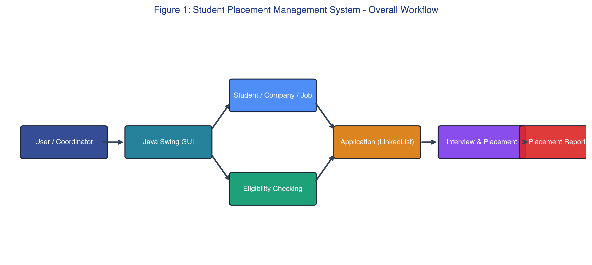

### Data Structure Architecture
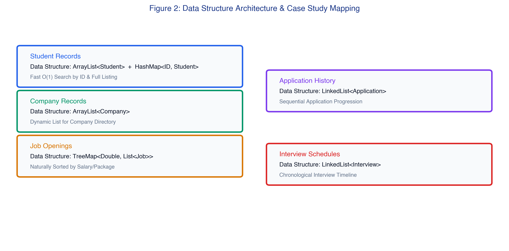

### Automated Two-Phase Eligibility Workflow
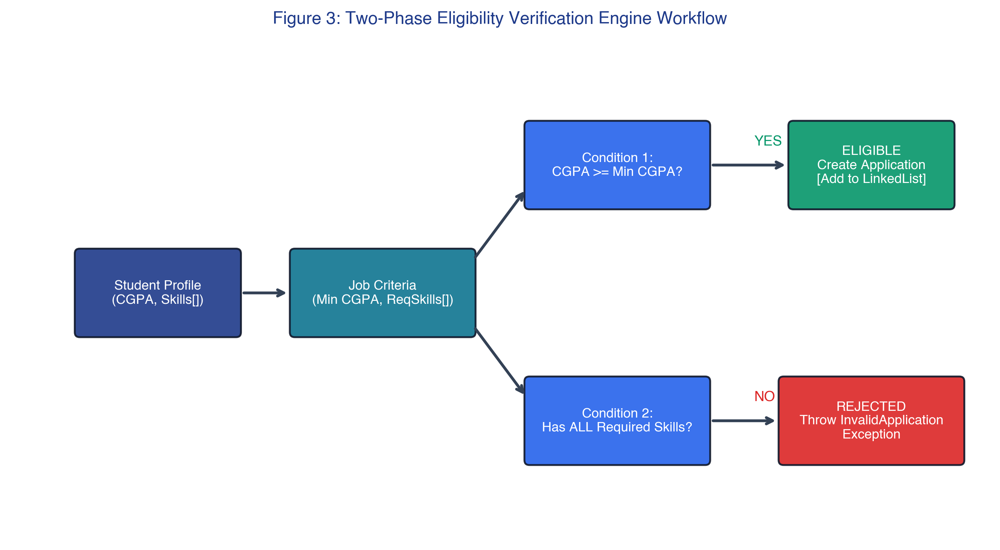

### Placement & Interview Workflow
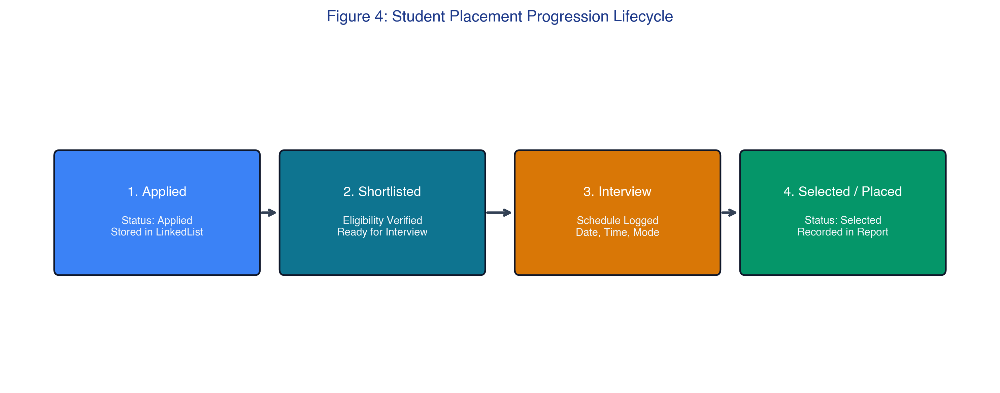

---

## 6. How to Compile and Run

The entire system is self-contained in a single, well-structured Java file (`StudentPlacementManagementSystem.java`) with **zero external dependencies** and **no database configuration required**.

### Prerequisites
- Java Development Kit (JDK 17 or higher recommended, JDK 11+ compatible).

### Step 1: Open Terminal
Navigate to the repository directory:
```bash
cd "student-placement-management-system"
```

### Step 2: Compile
Compile the Java source code:
```bash
javac StudentPlacementManagementSystem.java
```

### Step 3: Run
Launch the desktop application:
```bash
java StudentPlacementManagementSystem
```

---

## 7. GUI Screenshots & Module Walkthrough

The application features a modern Java Swing interface with card metrics, custom tables, tabbed navigation, and interactive modal dialogs.

### 1. Central Executive Dashboard
Displays live placement statistics cards, application funnel metrics, and system quick-start instructions.
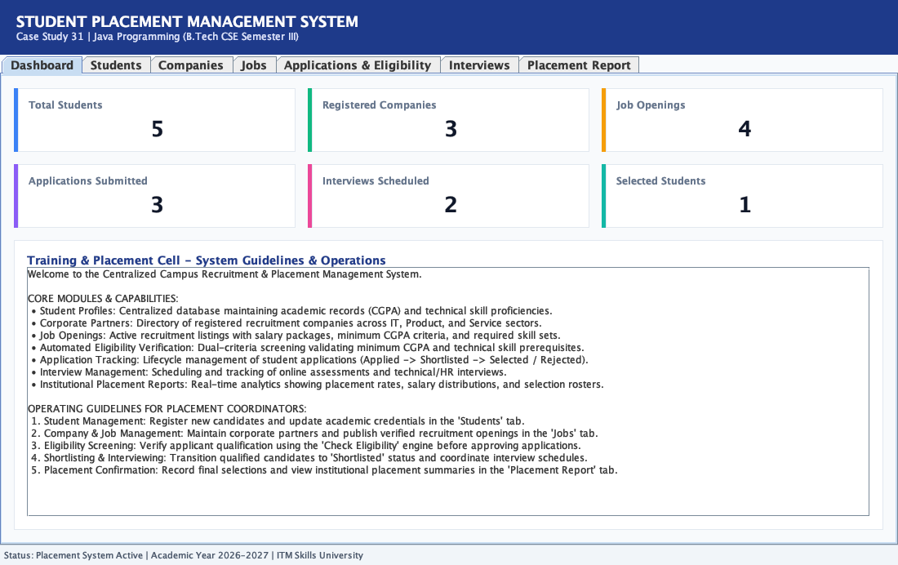

### 2. Student Records Management
Full CRUD interface for student profiles with instant search and tabular display.
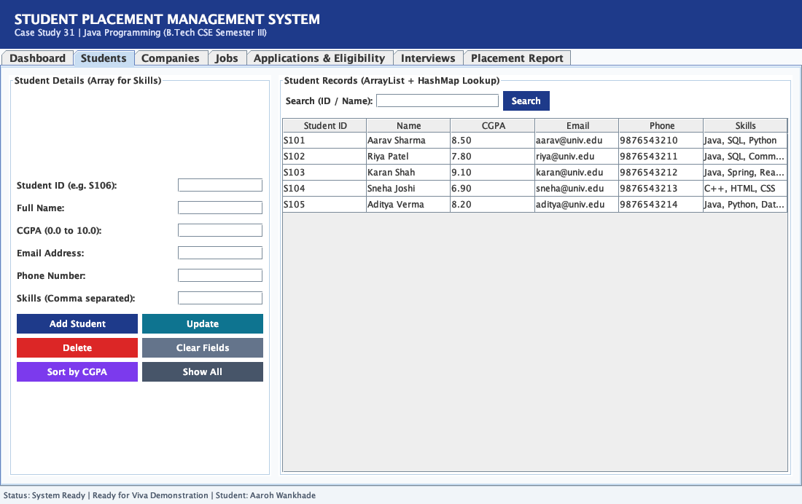

### 3. Adding a Student with Field Validation
Modal dialog validating student ID format, CGPA limits (0.0 to 10.0), email, phone, and technical skills.
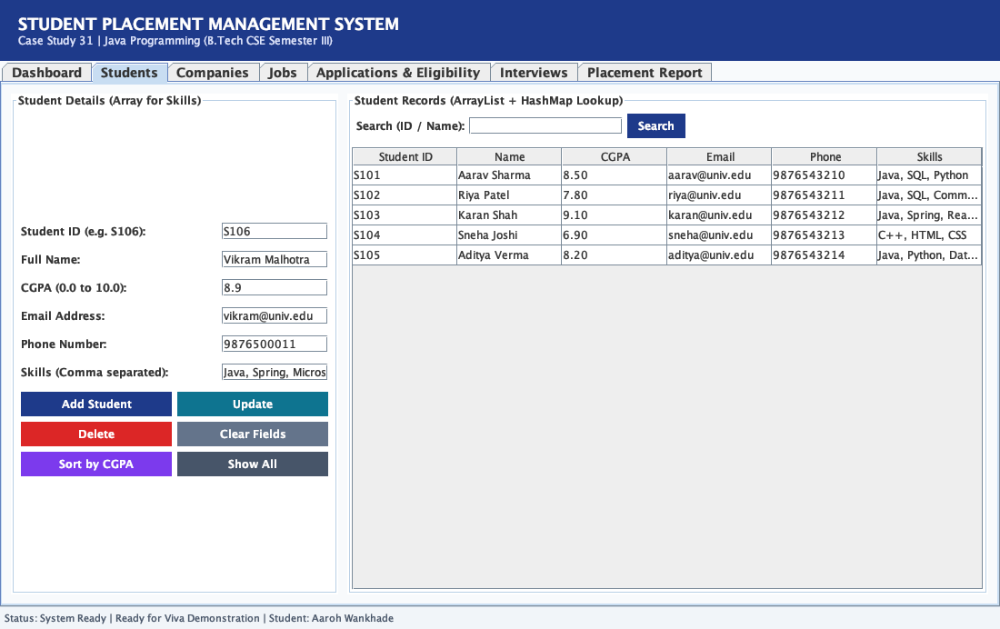

### 4. Sorting Students by CGPA (Bubble Sort)
Demonstrates in-place Bubble Sort algorithm arranging student records in descending order of CGPA.
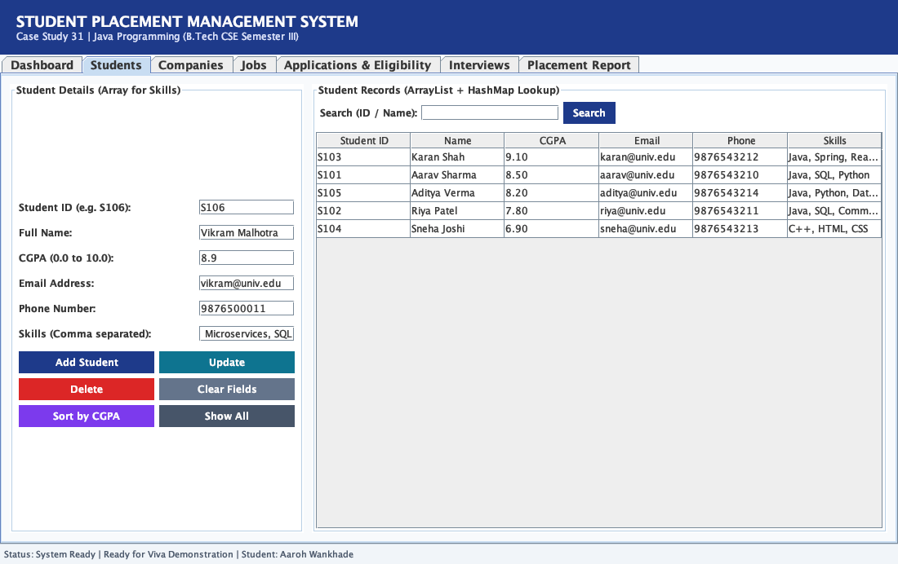

### 5. Recruiting Company Management
Management interface for corporate partners, headquarters location, and industry domain.
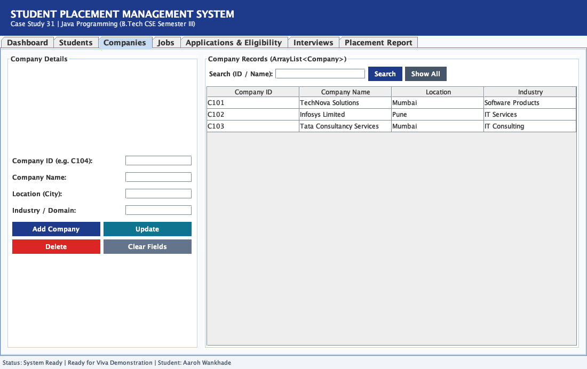

### 6. Job Openings Directory
Tracks job titles, recruiting company, salary packages (LPA), minimum CGPA cutoffs, and required skill sets.
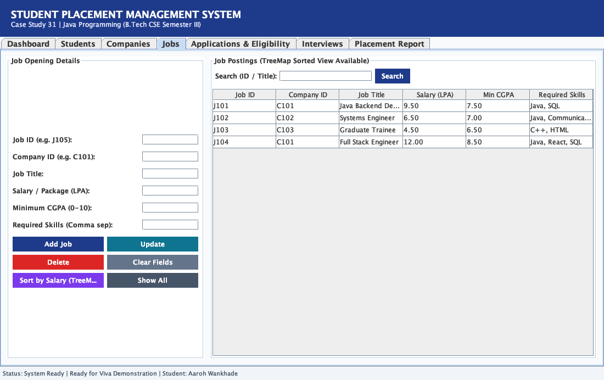

### 7. Sorting Job Openings by Salary (`TreeMap`)
Demonstrates Red-Black Tree traversal rendering job packages ordered from highest to lowest.


### 8. Two-Phase Eligibility Verification Engine
Simulates automated eligibility check comparing candidate CGPA and skill array against job criteria.


### 9. Application Tracking Pipeline
Chronological `LinkedList` tracking application stages from `Applied` to `Shortlisted`, `Selected`, and `Rejected`.
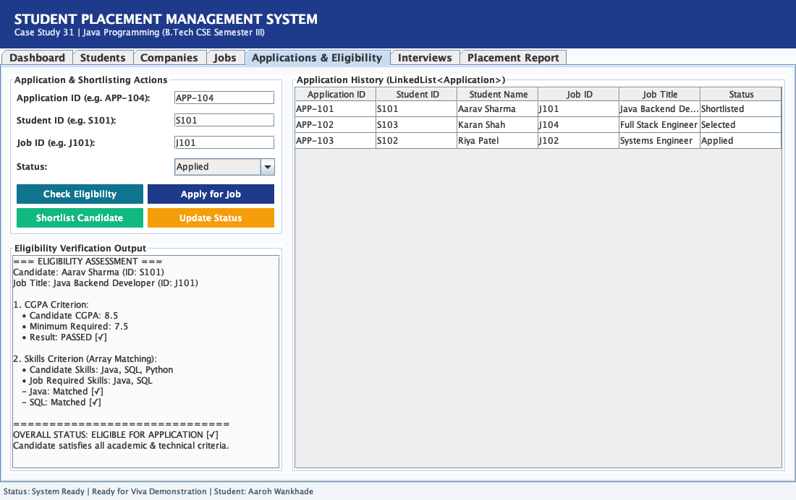

### 10. Interview Scheduling Module
Allows placement coordinators to schedule technical and HR interviews with date, time, and mode (Online/Offline).
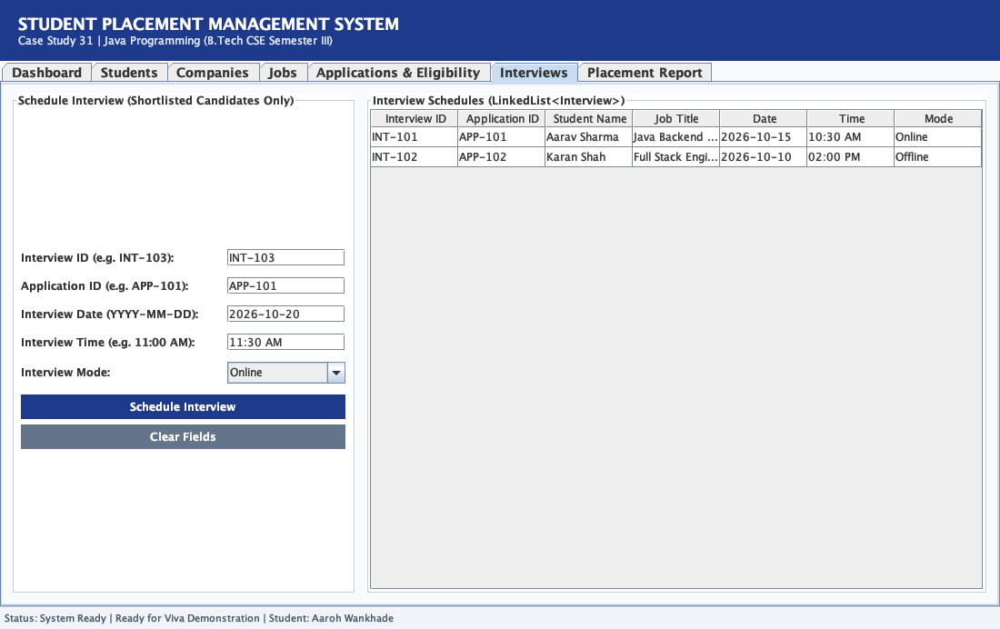

### 11. Consolidated Placement Analytics Report
Summary of placement percentages, top package, average salary, and roster of successfully placed students.
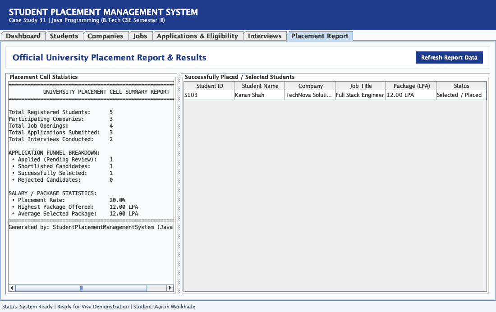

---

## 8. Exception Handling & Validation

The system strictly enforces defensive programming and input validation:

### 1. Form Validation Error Handling
Rejects out-of-bounds CGPA entries (e.g., > 10.0) or invalid phone numbers with clear user prompts.
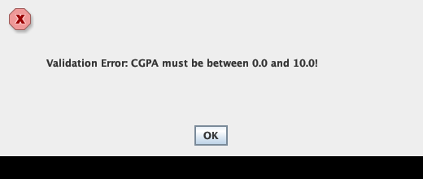

### 2. Custom Exception: `InvalidApplicationException`
Triggered when an ineligible student attempts to apply for a role with higher CGPA cutoffs or missing skills.
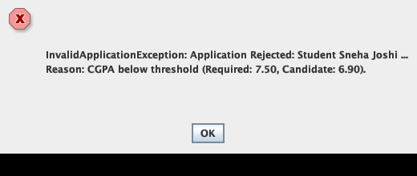

### 3. Custom Exception: `InvalidInterviewException`
Triggered when attempting to schedule an interview for an applicant whose status is not `Shortlisted`.

---

## 9. Repository File Structure

```text
student-placement-management-system/
├── StudentPlacementManagementSystem.java   # Complete Core Java & Swing source code (Single File)
├── PROJECT_REPORT.pdf                     # Official 14-page university project report PDF
├── README.md                              # Comprehensive documentation and project guide
├── .gitignore                             # Clean Git configuration excluding bytecode and temp files
├── assets/                                # University and departmental logos
│   ├── itm_logo.png
│   └── futuretech_logo.png
├── diagrams/                              # High-resolution architectural and workflow diagrams
│   ├── diagram1_system_workflow.png
│   ├── diagram2_data_structure_architecture.png
│   ├── diagram3_eligibility_workflow.png
│   └── diagram4_placement_workflow.png
└── screenshots/                           # 13 authentic GUI execution proof captures
    ├── 01_dashboard.png
    ├── 02_students.png
    ├── 03_add_student.png
    ├── 04_sort_students_cgpa.png
    ├── 05_companies.png
    ├── 06_jobs.png
    ├── 07_sort_jobs_salary.png
    ├── 08_eligibility_checking.png
    ├── 09_applications.png
    ├── 10_interviews.png
    ├── 11_placement_report.png
    ├── 12_validation_error.png
    └── 13_exception_handling.png
```

---

## 10. Submission Files Summary

When submitting this project for academic evaluation:

1. **Source Code:** [`StudentPlacementManagementSystem.java`](./StudentPlacementManagementSystem.java) — All-in-one executable source containing all classes, models, exceptions, collections, algorithms, and Swing GUI.
2. **Official Documentation:** [`PROJECT_REPORT.pdf`](./PROJECT_REPORT.pdf) — Complete 14-page formatted university project report containing syllabus mappings, code walkthrough, test cases, and execution results.
3. **GitHub Repository:** [https://github.com/aarohwankh-dotcom/student-placement-management-system](https://github.com/aarohwankh-dotcom/student-placement-management-system) — Clean, version-controlled repository for portal link submission.

---

**Developed & Submitted By:**  
**Aaroh Wankhade** (PRN: 150096726175)  
B.Tech Computer Science & Engineering (2025–2029)  
School of FutureTech, ITM Skills University
